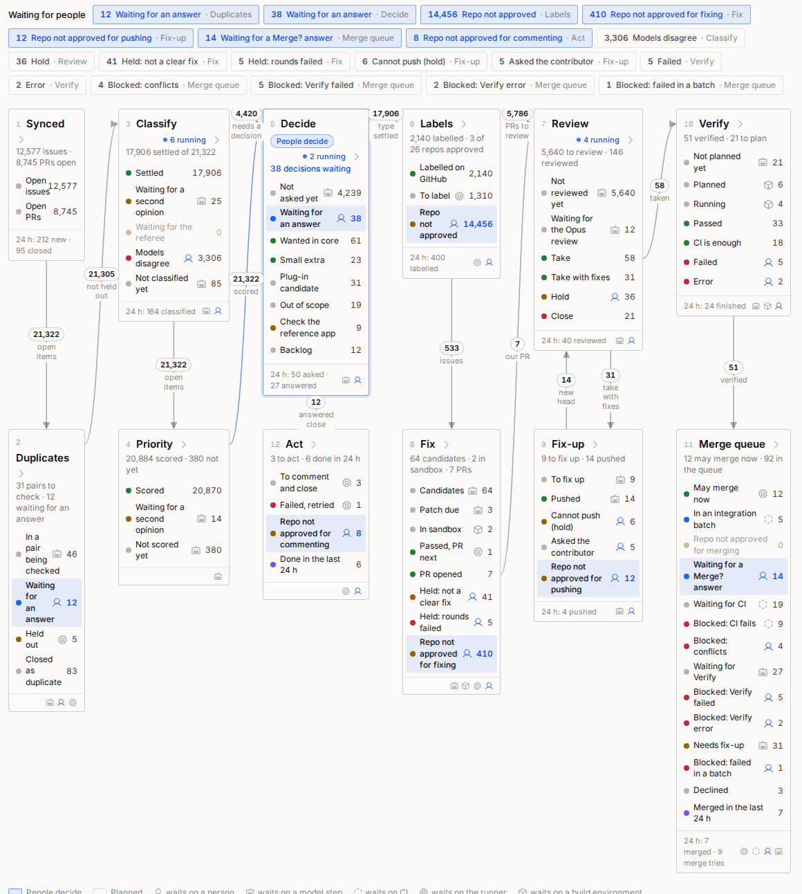

# AutoCraft

AutoCraft is a model harness for maintaining GitHub repositories with a large backlog. It mirrors every issue and PR into a local database and runs a pipeline of model steps over them. Jev classifiers and Claude Haiku, Sonnet and Opus classify, prioritise, find duplicates, ask maintainers for decisions, review, write fixes, verify and merge.

The models' tools are a fixed set of GitHub actions (comments, labels, branches, PRs, merges), all behind one write module and `safe-merge`-style checks. Actions run automatically where the rules say they are safe. Otherwise a model proposes and a person accepts. Each issue and PR has its own conversation between Opus and a maintainer, with action cards the maintainer can run. The pipeline is built around maintainers' judgement, which is the limited resource, not around token cost.

It was written for the [storytold](https://github.com/storytold) craft apps. The organization name is a constant (`ORG` in `src/mirror.ts` and `src/act/templates.ts`); tracking another organization means changing it.

## How it works

Stages run in this order. Details, limits and rules for each are in [docs/pipeline.md](docs/pipeline.md).

<!-- stages:begin stage-table (generated by npm run docs; do not edit) -->
| Stage | What it does | Model | Stops for a person |
|---|---|---|---|
| Sync | Mirrors every issue, PR and comment of the tracked repos into the local database each minute, and makes a vector of each item's title and body for similar-item search. | Local embedding model | no |
| Duplicates | Finds items that describe the same bug or request as another open item, or one closed in the last year, and compares each group. | Jev, Haiku, Opus, Sonnet | yes: duplicate? decision |
| Classify | Gives each open item one type label and two flags (security, needs decision). Jev goes first, Haiku gives a second opinion, and a referee settles disagreements outside the scope labels. | Jev, Haiku, Sonnet, Opus | yes: labels the models disagree on |
| Priority | Gives each open item a level from P0 to P4, then orders the candidates of later stages by a work rank. | Jev, Haiku | no |
| Decide | Asks an operator for scope calls, with a summary and a recommendation, and answers questions about an item in its conversation. | Sonnet, Haiku, Opus | yes: an operator answers |
| Label | Writes each settled type label and flag to GitHub. A label a person set is never changed. | none | yes: per-repo approval |
| Review | Opus reviews every wanted PR at its current head, reading the repo, and gives a verdict with the complete fix list. It writes nothing to GitHub until the final review is posted. | Opus | yes: hold, close and merge-outside-rule verdicts |
| Fix | Writes a patch for a bugfix issue where the fix is clear, tests it in the sandbox and opens a PR. | Sonnet, Opus, Haiku | yes: per-repo approval |
| Fix-up | For a take-with-fixes review, applies the listed small fixes to the contributor's branch, or posts them as a comment when the branch cannot be pushed to. | Sonnet, Opus | yes: per-repo approval |
| Verify | Records upstream CI as the verification of taken PRs in repos that have it. A repo without CI, and a bugfix that changes a test file, get a model-planned build in a build environment; a model summarises failures. | Sonnet, Haiku | yes: failures and errors |
| Merge queue | Merges PRs that pass the rules in integration batches (up to 50 PRs, checked by upstream CI on the batch PR) through safe-merge, and asks for a Merge? decision on PRs outside the rules. Approves held CI runs of outside contributors where the repo allows it. | Haiku | yes: merge? decision for PRs outside the rules |
| Act | Makes the comments and closes that follow an operator's answer, from fixed templates. | none | yes: per-repo approval |
| Post-merge review | Opus reviews each PR the pipeline merged a second time, reading what landed with the pipeline's own commits and reviews of the PR, and lists defects and minor findings. Each defect that no open item covers becomes one follow-up issue in repos approved for commenting; minor findings are only shown. | Opus | yes: per-repo approval |
<!-- stages:end stage-table -->



The image is the dashboard's home page (mock data). Each column is a stage with its counts, and the chips above it list what waits for a person.

### Trust boundaries

- Untrusted code runs only in a separate build environment (a worker as another OS user, with rootless Podman), never where GitHub or Claude credentials are.
- Model calls that use tools run inside a bubblewrap sandbox. They get `Read`, `Grep` and `Glob` on read-only checkouts of the public tracked repos, a Haiku explorer subagent, and read-only item tools (search, item, similar items, PR diff) over a snapshot of the public items. Other calls run without tools.
- Only `src/github/write.ts` writes to GitHub. Every write is recorded in an audit table, and a test fails if another file writes.
- Every GitHub write needs an operator's approval for that repo. Approvals are given on the dashboard and cannot be set from the CLI.
- The dashboard needs GitHub sign-in. Roles are `operator` (answers, approvals, switches, accounts), `maintainer` (read and comment) and `viewer` (read only).
- A pipeline switch (on/off) turns the whole pipeline off, a per-repo pipeline switch limits it to chosen repos, and each step has a daily limit.

See [Trust boundary](docs/pipeline.md#trust-boundary).

## Setup

### Requirements

| Needed | Used for |
|---|---|
| Node 24 or later (`engines` in `package.json`), pnpm | Runs the TypeScript directly; SQLite through the built-in `node:sqlite` |
| `gh`, logged in | Sync (`gh api graphql`) and every GitHub write |
| `git` | Clones, diffs and pushes |
| `claude` (Claude Code CLI) | All Claude calls |
| `bwrap` (bubblewrap, `/usr/bin/bwrap`) | Sandbox for tool-using calls. Without it, those calls run without tools; `AUTOCRAFT_NO_SANDBOX=1` forces that |
| `jev` (optional) | CLI for TypeSafe's Jev model, used by the classify, priority and duplicate steps (`jev --compact ask`). Without it, switched off (`autocraft accounts jev off`), or when its account is out of credit or its key is rejected, Haiku does Jev's work through the Claude accounts (more Claude usage) |
| Podman and a second OS user | Build environments for Verify and Fix (optional) |
| `sqlite3`, `curl` | `deploy/backup.sh` and `deploy/hook.sh` |

### Install

```sh
git clone https://github.com/aiongg/autocraft.git
cd autocraft
pnpm install
pnpm -C web install && pnpm -C web build    # writes web/dist
node src/cli.ts                             # lists every command
```

`autocraft` is the `bin` of `package.json`; `node src/cli.ts <command>` runs the same program. The database is `$AUTOCRAFT_DB`, default `~/.local/share/autocraft/mirror.db`.

### GitHub access

`gh` needs an account with read access to the tracked repos for Sync. The same account writes (labels, comments, closes, pushes, merges) in the repos an operator approves, so it needs write access there.

### Dashboard sign-in (GitHub OAuth App)

Create an OAuth App on GitHub:

- Homepage URL: your dashboard origin, for example `https://autocraft.example.com`.
- Authorization callback URL: `https://autocraft.example.com/auth/callback`. It must equal `<AUTOCRAFT_BASE_URL>/auth/callback` exactly.
- No scopes are requested. Expiring user tokens are supported.

Write the client ID, client secret and a random session key (at least 32 characters) to a JSON file with mode 0600:

```json
{ "github_client_id": "...", "github_client_secret": "...", "session_key": "..." }
```

Point `AUTOCRAFT_SECRETS_FILE` at it. The server refuses to start if the file is missing, incomplete, or readable by group or others.

| Variable | Meaning |
|---|---|
| `AUTOCRAFT_BASE_URL` | Public origin of the dashboard, no path |
| `AUTOCRAFT_LISTEN` | `host:port`, default `127.0.0.1:8993` |
| `AUTOCRAFT_DB` | Database path |
| `AUTOCRAFT_SECRETS_FILE` | The secrets file above |
| `AUTOCRAFT_WEB_DIST` | Built frontend, default `web/dist` |
| `AUTOCRAFT_TRUST_PROXY` | `1` behind a proxy that sets `X-Forwarded-For` |

The server speaks plain HTTP; put a reverse proxy with HTTPS in front. More variables are in [docs/operations.md](docs/operations.md).

### Claude accounts

Claude calls run under accounts that an operator enables. Each account is a Claude Code config directory that is logged in. Describe them in a JSON file and set `AUTOCRAFT_ACCOUNTS` to its path:

```json
[{ "id": "a", "configDir": "/srv/autocraft/config/claude/a" }]
```

`configDir` becomes `CLAUDE_CONFIG_DIR` of the `claude` child process. Related variables:

| Variable | Meaning |
|---|---|
| `AUTOCRAFT_ACCOUNTS_ROOT` | Directory for accounts added on the dashboard's Accounts page, which runs `claude auth login` for you |
| `AUTOCRAFT_USAGE_DIR` | One `<id>.json` per account with its rate-limit readings |
| `AUTOCRAFT_CLAUDE_BIN` | The `claude` command, default from `PATH` |

New accounts start disabled. Enable and size them:

```sh
autocraft accounts list
autocraft accounts set a --label main --enabled yes --max-concurrent 3
autocraft accounts jev 4        # parallel Jev calls
autocraft accounts jev off      # Haiku does Jev's work; `on` switches Jev back on
```

See [Claude accounts and agent runs](docs/pipeline.md#claude-accounts-and-agent-runs).

### Track repos and sync

```sh
autocraft repos track <name>     # a repo of the organization, without the owner
autocraft repos list
autocraft sync                   # first sync of the tracked repos
```

A newly tracked repo has its pipeline off: only Sync, Embed and Rank run for it. After the first sync, `autocraft sync` runs every minute from a timer (`deploy/systemd/autocraft-sync.timer`). `autocraft embed` fills the vectors; the first run downloads a 34 MB embedding model.

### Start the dashboard and add the first operator

```sh
autocraft access add <github-login> --operator
autocraft dash serve
```

Sign in at the base URL. Further users are added on the Access page or with `autocraft access add <login> [--maintainer]`. Then, on the dashboard:

1. Repos page: approve each repo for the writes you want (labels, comments, fixing, pushing, merging) and switch its pipeline on.
2. Run the runner: `autocraft runner serve`. It is the only process that runs steps.
3. Pipeline page: turn the pipeline on, or `autocraft pipeline on`. Set daily limits with `autocraft pipeline limit <step> --per-day N`.

`AUTOCRAFT_DEV_AUTH=1 autocraft dash serve` starts a local server with a fake GitHub sign-in on `127.0.0.1:8994`, with no secrets file.

### Deployment

`deploy/` holds a production layout that runs the dashboard, runner, sync timer and a daily backup as systemd units of one unprivileged user. It deploys by `git push` to a bare repository.

| File | Use |
|---|---|
| `autocraft.env.example` | Settings file, for example `/srv/autocraft/config/autocraft.env` |
| `systemd/` | Dashboard, runner, sync and backup units (`@ROOT@`, `@USER@` placeholders) |
| `post-receive`, `hook.sh`, `push.sh` | Push-to-deploy: builds a release directory and switches the `app` symlink |
| `backup.sh` | Consistent SQLite snapshots |
| `craft-runner.service`, `craft-worker.service` | User units for the runner and the sandbox worker |

Details, including the worker and build environments: [docs/operations.md](docs/operations.md).

## Development

```sh
pnpm test        # node --test
pnpm check       # tsc --noEmit
pnpm -C web dev  # frontend on http://127.0.0.1:5173 with mock data
VITE_MOCK=1 pnpm -C web build   # static mockup build, no server needed
```

The mock API serves fixture data; pick the role with `?as=operator|maintainer|viewer`. See [web/README.md](web/README.md) and [docs/ui-design.md](docs/ui-design.md).

| Path | Contents |
|---|---|
| `src/cli.ts` | Entry point; commands come from modules listed in `MODULES` |
| `src/mirror.ts`, `src/db.ts`, `src/schema.sql` | Sync and the SQLite schema |
| `src/classify`, `src/priority`, `src/dupes`, `src/embed`, `src/rank` | Classification, priority, duplicates, embeddings, work rank |
| `src/decide`, `src/conversations`, `src/act` | Decisions, Opus conversations and cards, applying answers |
| `src/review`, `src/fixissue`, `src/fixup`, `src/verify`, `src/merge` | Review, fix, fix-up, verify, merge queue |
| `src/agents`, `src/prompts`, `src/sandbox`, `src/itemtools` | Claude accounts and calls, prompts, bubblewrap, read-only item tools |
| `src/github` | `write.ts`, the only module that writes to GitHub |
| `src/runner`, `src/worker`, `src/build` | Job runner, sandbox worker, build environments |
| `src/dash`, `src/flow` | Dashboard server, API and flowchart counts |
| `web/` | React frontend |
| `test/` | Tests |
| `docs/` | `pipeline.md`, `dashboard-spec.md`, `ui-design.md`, `operations.md` |

## License

AutoCraft is dual-licensed under [MIT](LICENSE-MIT) or [Apache-2.0](LICENSE-APACHE), at your option.
