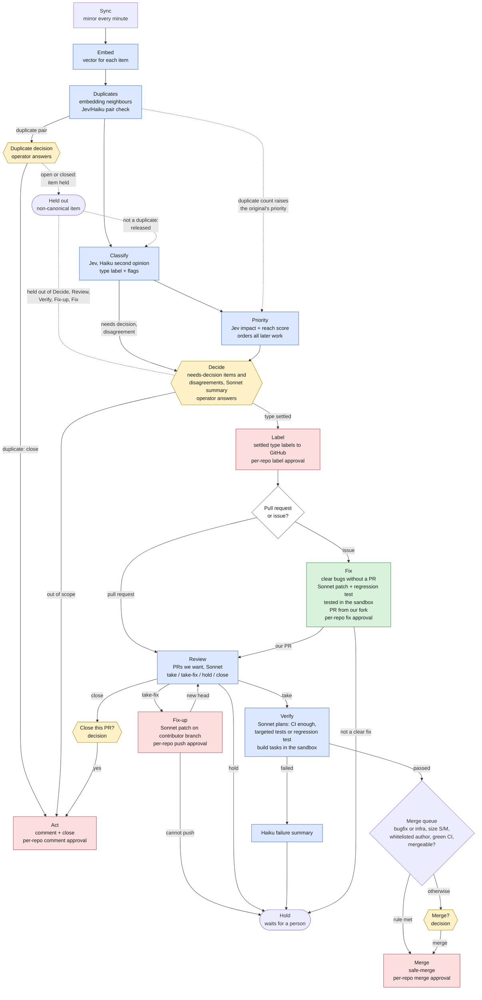

# How the triage pipeline works

The craft apps have about 21,000 open issues and PRs. The pipeline sorts all of them, reviews and merges the PRs we want, and fixes clear bugs. People make the calls that need judgement: they answer decisions on this dashboard. Models do the reading, sorting and reviewing.

## The flow

Items move from the top to the bottom. Each box is a stage; the arrows show where its result goes. Yellow boxes are decisions a person answers on the dashboard, blue boxes are model calls, green boxes run in the sandbox build environment, and red boxes write to GitHub. Every red box waits for the operator's approval for that repo, given on the Repos page, and for its daily limit.

1. **Sync.** Every issue, PR and comment is mirrored into the local database each minute. Later stages read the mirror. See [Stages](#stages).
2. **Duplicates.** Each item gets an embedding vector; its nearest neighbours are paired up and Jev or Haiku checks each pair. A confirmed pair becomes a duplicate decision for the operator. The newer, non-canonical item is held out of Decide, Review, Verify, Fix-up and Fix issues while that decision is open or answered close; "not a duplicate" releases it. An answer of close goes on to Act. The number of duplicates raises the original's priority. See [Duplicates](#duplicates).
3. **Classify.** Jev gives each open item a type label and two flags; Haiku gives a second opinion where Jev is unsure. See [Stages](#stages).
4. **Priority.** Jev scores each item's impact and reach. The score orders all later work, so the most useful items go first. See [Priority](#priority).
5. **Decide.** Where the classification is settled (Jev at 90 % or more, or Haiku agreeing), the pipeline goes on by itself. Items that need a decision, and items where the classifiers disagree, get a Sonnet summary. The operator answers on the dashboard. Out-of-scope answers go on to Act. See [Scope decisions](#scope-decisions).
6. **Label.** Settled type labels are written to GitHub, one repo at a time, once the operator has approved labels for that repo. See [Label stage commands](#label-stage-commands).

From here the path depends on the item: pull requests go to Review, issues go to Fix, and both end in Verify and the merge queue.

7. **Review** (pull requests). Sonnet reviews the PRs we want and answers take, take-fix, hold or close. See [Stage 5: Review](#stage-5-review).
   - **Fix-up.** For take-fix, Sonnet writes a patch for the contributor's branch and we push it where the repo's push approval and the branch allow. If we cannot push, the PR is held. The PR is then reviewed again at its new head. See [Fix-ups](#fix-ups).
   - **Close.** For close, the operator answers a "Close this PR?" decision. A yes goes to Act, which posts a short comment and closes the PR once the repo's comment approval is given. See [Act: comments and closes](#act-comments-and-closes).
8. **Fix** (issues). For a clear bug without a PR, Sonnet writes a patch and a regression test, the sandbox builds and tests them, and we open a PR from our fork, once the repo's fix approval is given. That PR goes to Review like any other. See [Stage 7: Fix issues](#stage-7-fix-issues).
9. **Verify.** For take, Sonnet plans the checks: green CI is enough, targeted tests, or a regression test. Build tasks run in the sandbox build environment, and exit codes decide pass or fail. A failure gets a Haiku summary and the PR is held. See [Stage: Verify](#stage-verify).
10. **Merge queue and Merge.** A verified PR that is a bugfix or infra change, size S or M, by a whitelisted author, with green CI and no conflicts, goes straight to the merge step. Any other PR becomes a "Merge?" decision. The merge runs through `safe-merge` once the repo's merge approval is given. See [Stage 6: Integrate](#stage-6-integrate).

## Stages

| # | Stage | What happens | Who or what does it | Status |
|---|---|---|---|---|
| 1 | Mirror | Every issue, PR and comment of the tracked repos is copied into a local database. Later stages read the mirror, never GitHub directly. | `craft-auto sync`, every minute: one org-wide GitHub search for changes, in time slices of at most 1,000 results | Automatic |
| 2 | Classify | Every open item gets one type label (bugfix, performance, missing feature, small extra, plugin candidate, infra) and two flags (security, needs decision). | Jev first. Where Jev is under 90 % sure, Haiku as well. Where they disagree, the item goes to a person or to Sonnet | Scripted, started by the operator (`craft-auto classify`) |
| 2b | Duplicates | Open issues and PRs that describe the same bug or request as another open item, or as one closed in the last year, in the same repo, become "Close as a duplicate?" decisions. Runs right after Embed and before Decide. | Jev first (accepted at 0.9 either way), Haiku for the rest; the operator answers | Built (`craft-auto dupes`, step `dupes`) |
| 2c | Priority | Every open item gets an impact class (critical, high, normal, low) and a 0 to 100 score. Decide, review, verify and fix-up take the highest score first. | Jev first. Where Jev is under 90 % sure, Haiku decides. The score adds reach from the mirror: no model | Automatic (`prioritize` step), daily limit 3000 |
| 3 | Decide | Items flagged "needs decision" (scope, wanted or not, reference-app behaviour), and items where Jev and Haiku disagree between scope labels, become decisions on this dashboard, each with an AI summary and the item's own text. | `craft-auto decide` asks them, with summaries by Sonnet. The operator answers; anyone signed in can comment and pick an option | Scripted, started by the operator |
| 4 | Label | The type label and flags go onto the item on GitHub. | `craft-auto labels`, one repo at a time. No model calls. Only items whose type is settled (Jev at 90 % or more, or Haiku agreeing with Jev) are labelled. A label a person set is never changed: an item that already has a different type label is skipped and reported. Writes to GitHub need the operator's approval for that repo, given on the Repos page | Built. `ensure` and `plan` are read-only; `apply` is a dry run unless `--apply` and refuses unapproved repos |
| 5 | Review | PRs we want get a code review: take, take with fixes, hold, or close (duplicate, already fixed, superseded). | Sonnet, one call per batch of related PRs. Tests are not reviewed, only code | Built, one repo at a time (`craft-auto review`) |
| 6 | Integrate | Taken PRs are assigned to us, fixed up on the contributor's branch where possible, grouped into integration branches and merged when GitHub CI is green. | Sonnet implementers; merges only through a checked merge script | Merge queue and merge step built (`craft-auto merge`); fix-ups and integration branches next |
| 7 | Fix issues | Issues with a clear bug and a clear fix get a PR from us. | Sonnet implementers | Planned |

Stages 5–7 go one or a few repos at a time, in turn. Stages 1–4 cover the whole org.

## Duplicates

`craft-auto dupes [--limit N] [--dry-run]` (step `dupes`, group dupes, operator only, models Jev and Haiku) runs after Embed and before Decide. It reads the local database and the item vectors and calls models; it writes nothing to GitHub.

**Candidates.** An open item is scanned when its text hash (`embed_hash`) has no row in `duplicate_scans`: new items and items whose text changed. Its nearest neighbours in the same repo come from the vector index. A neighbour becomes a pair when its similarity is at least 0.86 and it is open or was closed or merged within the last year. At most 3 neighbours are kept per scanned item. The threshold is the top quartile of nearest-neighbour similarity in the real data (bge-small, three repos with 2,155 open items: the best neighbour of half the items scores 0.85 or more, of a tenth 0.92 or more, of one in a hundred 0.96 or more; true duplicates sit above about 0.9, and below 0.8 the pairs are only related). The first scan of those 2,155 items gave 622 pairs, 186 of them at 0.9 or more and 34 at 0.95 or more. Both items are of the same kind (issue and issue, PR and PR). An item is never compared with itself, a PR is never compared with an issue it closes, and a pair an operator ruled on is not added again.

**Pair check.** Prompt `dupes.jev` asks Jev "Do these two describe the same bug or request?". At 0.9 or more the pair is a duplicate, at 0.1 or less distinct. In between, prompt `dupes.haiku` (batches of 10) answers duplicate, distinct or unsure; a Haiku "duplicate" counts only when Jev's probability was at least 0.5, else the pair is stored as unsure. Sonnet is not used. The result is in `duplicate_pairs`: repo, a < b, similarity, `jev_p`, `haiku`, `verdict` (`duplicate`, `distinct`, `unsure`), `canonical`, `checked_at`. A pair is keyed by repo, both numbers and both text hashes, so it is checked once per pair of texts; edited text is checked again. Pairs that are not yet answered have no verdict and are tried in the next run.

**Which one stays (canonical).** In order: an item that is closed or merged; an issue a merged PR fixes; the one with at least 5 more comments; the older one; the lower number. Items joined by duplicate pairs form a group with one canonical item, so a chain a~b~c never closes b as a duplicate of an item that is itself closing.

**Decision.** Each open member of a group other than the canonical gets one decision `<repo>#<x>:duplicate@<y>`, "Close #x as a duplicate of #y?", with options Close as duplicate (`close`), Not a duplicate (`distinct`) and Keep both (`keep`). Facts: both titles with kind, state and comment count, the similarity and model verdicts, and `duplicate of <repo>#<y>`. An item has at most one open duplicate decision.

**Answers.** Only an operator's answer counts. `close` is applied by the act step: it posts `Duplicate of #y.` (`..., which is closed.` when the original is no longer open on GitHub at that moment), then closes #x, under the same comment approval, daily limit and re-check before writing as the other closes. `distinct` and `keep` store the pair as distinct for good (`by_operator`), so it is never asked again, even after the text changes.

**What it holds back.** While a duplicate decision for a PR or issue is open, or was answered `close`, the item is left out of the candidates of Decide, Review, Verify and Fix-ups. `distinct` and `keep` release it. Helpers: `duplicateHeld` and `notHeldSql` (src/dupes/held.ts), `duplicateCount` (open duplicates pointing at an item).

**Limits.** The step's `limit` (default 2000, at most 5000) is the number of pairs sent to a model per job; the daily limit defaults to 2000 pairs until an operator sets another.

## Stage 5: Review

`craft-auto review --repo R [--limit N] [--dry-run]` reviews one repo. The pipeline's runner calls the same code as `runReview(db, {repo, limit, dryRun}, log)`.

**Which PRs.** Open, non-draft PRs whose settled type label is bugfix, performance, missing feature, small extra or infra. A PR flagged "needs decision" waits until its scope decision is answered `take` or `small-extra`; any other scope answer keeps it out. A PR already reviewed at its current head commit is skipped, so a run can stop and restart at any point, and a push to a reviewed PR brings it back. `--limit` takes the smallest PRs first.

**What the reviewer sees.** For each PR: title, body, size (S up to 50 changed lines, M up to 300, L above), CI state, mergeability, the files it changes, and the diff of its code. Test files and lockfiles are listed but left out of the diff; a PR that changes only tests shows its tests. Other PRs in the run that change the same files are named, so the reviewer can mark overlaps and duplicates.

**Data.** CI and merge state come from one GitHub query per 40 PRs and go into `pr_checks` (head commit, state per check, overall success, failure, pending or none, mergeable, maintainer can modify). `craft-auto checks --repo R` refreshes it for every open PR of a repo. Diffs come from `gh pr diff` and are cached by head commit under `$CRAFT_AUTO_DIFF_CACHE` (default `~/.cache/craft-automation/diffs`). The stage reads GitHub and never writes to it: comments, labels and assignments belong to stage 6.

**Batches.** PRs that share a file go into the same call where they fit, then PRs of the same area. A call holds at most 15 PRs and 120,000 characters of diff. A PR with more than 1,500 changed code lines, or one GitHub won't return a diff for, is held as too large to review automatically without a model call.

**Prompt.** `review.sonnet` on [Prompts](/prompts), sent to Sonnet with no tools. Diffs and PR text are quoted as untrusted data.

**Verdicts.**

| Verdict | Meaning |
|---|---|
| take | Wanted, correct, nothing to change |
| take-fix | Wanted and nearly right; small mechanical fixes are listed per file |
| hold | Needs a person: unsure reference behaviour, a design or scope choice, overlaps that need a choice, a duplicate whose better PR has not merged, or too large to review automatically |
| close | Wrong or broken beyond a small fix, not wanted, already done on the main branch, or superseded |

The weaker of two duplicates is held, never closed, until the better one has merged; a close that names an unmerged duplicate is stored as a hold.

**Storage.** One `reviews` row per PR and head commit: verdict, reason (25 words at most), fixes, duplicate_of, overlaps, risks, model, size, run. Each review also adds two `stages` rows: `reviewed` (verdict, short head commit and reason) and the verdict itself (`take` for take and take-fix, `hold`, `close`), which the Progress page counts. Token use goes to `token_usage` with stage `review`.

## Stage: Verify

Sits between Review (5) and Integrate (6). Its step is numbered 6 in the runner, like the flow chart's Verify node. Planning and task creation are in `src/verify/index.ts`; result collection is in `src/verify/results.ts`.

**Which PRs.** Open, non-draft PRs of public repos whose latest review at the current head commit is `take` (a take-fix PR gets a fix-up push first, which is reviewed again), whose CI does not fail at that head, and that have no verification at that head. Only Rust repos: the repo needs a `Cargo.toml` at its root at that head. `craft-auto verify --repo R [--limit N] [--dry-run]` runs the step; the autopilot queues it per repo after a fresh `checks` job.

**Planner.** One Sonnet call per PR, no tools (prompt `verify.plan`). Inputs, all untrusted: title and body, the review's verdict, reason, risks and fixes, the code diff (same cache as Review), the settled type label, and the workspace's crate names with their directories (GitHub tree API at the head sha, cached by sha next to the diffs). The reply picks one kind:

| Kind | Meaning |
|---|---|
| `ci-enough` | No task; the reason is recorded |
| `tests` | Build plus tests of up to 5 named crates, optionally narrowed by test-name filters |
| `regression` | Only for PRs whose settled label is bugfix: a test file the planner writes, which should fail on the base commit and pass on the head |

Our code validates the reply and treats anything invalid as an error with no task: crates must be names from the listed workspace (at most 5, passed to cargo only as `-p <crate>`); a test filter matches `[A-Za-z0-9_:]{1,100}`; a regression test is at most 200 lines and is turned into a patch that adds exactly `<crate dir>/tests/autocraft_regression.rs`, which a parser of the diff checks again (one new file, additions only). Screenshots are not part of the plan yet. Pass or fail comes from exit codes, never from a model.

**Tasks.** Built with `rustPlan` (`src/worker/rust.ts`). Each requires `{ os: linux, toolchains: [rust-stable] }`, has step `verify` and `warm { key: <repo>, role: use }`. `tests` and `regression` queue a head task (head sha = PR head, base sha = PR base). `regression` also queues a base task: the same patch at the base commit, where the test is expected to fail. A task's `patch` (unified diff, at most 1 MiB) is applied to the checkout by the worker before its plan runs.

**Warm builds.** When a repo gets verification tasks and has no warm build for its default branch head, one task builds that head (all targets of the workspace, no tests) with `warm { key: <repo>, role: build }` at priority -10. At most one per repo per 24 hours.

**Storage.** One `verifications` row per PR and head commit: kind, reason (25 words at most), plan, model, head and base task ids, state (`planned`, `running`, `passed`, `failed`, `error`, `ci-enough`, `stale`), summary, created and finished times. Planning writes a `stages` row per PR: `verify-planned`, `verify-ci-enough` or `verify-error`; the Progress page counts them as take. Token use goes to `token_usage` with stage `verify`. The stage has a daily limit of PRs planned (default 30).

## Stage 6: Integrate

Built so far: the merge queue and the merge step. Integration branches come next.

**Merge queue.** Every PR whose latest review is take or take-fix at its current head commit, plus the ones merged since. [Merge queue](/queue) shows it, read-only, with one state per PR:

| State | Meaning |
|---|---|
| ready | The merge rule covers it, CI is green, Verify passed (or said CI is enough) at this head commit and it is mergeable: the next run merges it |
| decision-answered-merge | Outside the rule, but the operator answered the Merge? decision `merge` at this head commit |
| refused | The merge command or a pre-merge check said no; the reason is shown, and the next run tries again |
| waiting-ci | CI is pending or has not run at this head, or GitHub has not worked out mergeability yet |
| ci-failed | CI fails at this head |
| conflict | Conflicts with the base branch |
| needs-fix-up | The review is take-fix: it waits for the fix-up step |
| waiting-verify | No verification at this head commit yet, or it is planned or running (CI states are checked first) |
| verify-failed | The verification at this head commit failed; the summary is shown |
| verify-error | The verification at this head commit errored (invalid plan or task error after the retry) |
| needs-decision | Outside the rule, Verify passed or said CI is enough: it waits for the operator's answer to a Merge? decision (asked on the next run when not asked yet) |
| declined | The operator answered the Merge? decision `hold` or `close` |
| merged | Merged |

`craft-auto queue [--repo R]` prints the same list, with the verification state of each PR. A verification counts only at the head commit it was made for; one made at an older head is ignored.

**Merge without asking.** A PR merges without a decision only when all of these hold:

- the review verdict is take (not take-fix) at the PR's current head commit;
- its size is S or M (up to 300 changed lines);
- its settled type label is bugfix or infra (infra covers tests, CI, docs and build);
- its author is on the whitelist (tier whitelisted, or an operator's allow override; see Contributors);
- CI is `success` overall at that head commit;
- Verify passed at that head commit, or planned "CI is enough";
- GitHub reports it mergeable.

**Merge? decisions.** A take PR that fails any of the first four gets a decision instead, once its verification has passed or said CI is enough: "Merge this PR?" with options `merge`, `hold` and `close`, and facts for size and label, author and tier, CI and mergeability, the verification (kind, state, note), the review's verdict, reason and fixes, and the head commit. There is one decision per PR head commit, so a push brings a new one. It is asked only while CI is not failing, the PR has no conflict and the operator can see the verification result. Only an operator's answer counts, read as an option key (`craft-auto decisions list --actionable`). An answer of `merge` makes the PR eligible at that head: CI must still be green, Verify passed (or CI is enough) and the PR mergeable, and the step refuses when the head commit moved since the question was asked.

**Merge step.** `craft-auto merge --repo R [--limit N] [--apply]`; the runner calls `runMerge(db, {repo, limit, dryRun}, log)`. Without `--apply` (or with `dryRun` unset) it is a dry run: it prints what it would merge and ask, from the local tables, and calls and writes nothing. With `--apply` it:

1. writes a `batched` stage row for each queued PR, once per head commit, and asks the missing Merge? decisions;
2. takes the eligible PRs one at a time, rule PRs first, up to `--limit` merges;
3. refreshes that PR's checks and head commit, and refuses when it is no longer open, its head moved, the operator's answer is gone, or the verification at the refreshed head is not passed or ci-enough, or CI or mergeability changed;
4. assigns the PR to the pipeline's GitHub account (the signed-in `gh` account, read once per run) when nobody is assigned;
5. runs the merge command (`$CRAFT_AUTO_MERGE_CMD`, default `safe-merge`) as `<cmd> storytold/<repo> <n> --squash`, or `--merge` when the commits have more than one author. It never calls `gh pr merge` itself and never passes `--allow-pending`.

A refusal by the command is recorded with its reason and the PR stays in the queue. Any other error stops the run. Each try adds a `merges` row (head commit, rule or operator, squash or merge, merged or refused, reason) and an audit row (`assign`, `merge`, `merge-refused`); a merge adds a `merged` stage row and marks the operator's decision applied. The step makes no model calls.

### Label stage commands

- `craft-auto labels ensure --repo R [--apply]` creates the missing labels of the set (bugfix, performance, missing feature, small extra, plugin candidate, infra, security, needs decision) with colour and description. Without `--apply` it prints what it would create.
- `craft-auto labels plan --repo R [--run RUN] [--csv FILE|-]` prints counts (to add, already labelled, unsettled, conflicts) and writes a CSV of the labels per open item.
- `craft-auto labels apply --repo R --run RUN [--limit N] [--apply]` adds the planned labels in batches of 10 mutations, at most 60 writes a minute, waiting out rate limits. It writes a `labeled` stage row per item and one audit row per batch, and a re-run skips items already labelled. Without `--apply` it is a dry run. With `--apply` it refuses unless an operator approved the repo.

Merge approval: tracked repos include ones we do not maintain, so merging is opt-in per repo. The Repos page has a Merge approval column with a confirm button, operators only, audited (`merge-approve`, `merge-revoke`); the `merge` step and the autopilot refuse repos without it.

Approval: the Repos page has a Label approval column with a confirm button, operators only, audited (`labels-approve`, `labels-revoke`). The CLI reads the approval and cannot set it. The column also shows the plan counts: to add, skipped, conflicts.

### Fix-ups

A take-fix review lists small mechanical fixes. The fix-up step applies them to the contributor's branch, so the PR can merge without waiting for the contributor. `craft-auto fixup --repo R [--limit N] [--apply]` (dry run without `--apply`); the runner calls `runFixup(db, {repo, limit, dryRun}, log)` as step `fixup` (group `github-write`, Sonnet, autopilot lane `fixup`, daily limit 20 PRs).

**Candidates.** An open, non-draft PR whose review at its current head commit is take-fix, that GitHub lets maintainers modify, that does not conflict with the base branch, in a repo where an operator approved pushing (setting `push_approved:<repo>`, audited as `push-approve` and `push-revoke`; `POST /api/repos/push-approve` and `/push-revoke`; `craft-auto push-approval [--repo R]` prints it), with fewer than 2 earlier tries (`fixups` rows in state pushed, failed or refused). A PR we can't push to gets a `hold` stage row "can't push to the contributor's branch" and a `cannot-push` fix-up row, once per head commit, and no GitHub write.

**Per PR.**

1. Reads the PR from GitHub; skips it when it is closed, a draft, conflicting, or its head moved since the review.
2. Assigns it to the pipeline's GitHub account when nobody is assigned (audit `assign`), before any change.
3. Fetches `refs/pull/<n>/head` into a bare cache repository (`$CRAFT_AUTO_FIXUP_DIR`, default `~/.cache/craft-automation/fixups/<repo>`) over HTTPS with the `gh` credential helper. The checkout is untrusted: there is no working tree, so no hook, filter, textconv driver or submodule runs, and git runs with `core.hooksPath=/dev/null`, `protocol.file.allow=never` and `GIT_LFS_SKIP_SMUDGE=1`. Files are read with `git cat-file`.
4. Asks Sonnet (prompt `fixup.patch`, no tools) for a unified diff. It sees the review's fix list, the full current content of each file the list names and the PR diff, all quoted as untrusted. A file over 40,000 characters, more than 120,000 in all or a diff over 60,000 holds the PR as `too-large` without a model call.
5. Validates the diff: only files named in the fix list, at most 300 changed lines, no new, deleted, renamed, mode-changed, symlink or binary file, and `git apply --check` accepts it against the reviewed head. It applies the diff to a private index (no working tree), commits on top of the reviewed head as the pipeline's account (login and GitHub noreply address from `gh api user`) with the message "Apply review fixes" and one line per file, and checks the commit changes exactly the validated files without a mode change.
6. Pushes to the contributor's branch with `--force-with-lease=refs/heads/<branch>:<reviewed head>`, never a plain force, so a branch that moved since the review is left alone (recorded as refused).
7. Posts one comment from a template in code (`src/fixup/template.ts`, shown on the Prompts page): "Pushed the small fixes from review: `<files>`."

Each try adds a `fixups` row (repo, number, from_head, to_head, state, reason, files, attempt, created_at) and a stage row (`hold` for cannot-push and too-large, else `take` with a note), plus audit rows `assign`, `fixup-push` and `fixup-comment`. The pushed head has no review, so the Review stage selects the PR again once the mirror or the checks refresh show the new head; the merge queue then sees the new review.

## Priority

`craft-auto prioritize [--limit N]` rates open items; the pipeline's `prioritize` step (group `priority`, models Jev and Haiku) runs the same code as `runPrioritize(db, {limit})`.

**Impact.** Jev (prompt `priority.jev`) picks one class per item:

| Class | Meaning |
|---|---|
| critical | Crash, data loss, security hole, build or install broken, app unusable |
| high | A core feature is broken, or a regression |
| normal | Anything else |
| low | Cosmetic, wording, documentation, nice-to-have |

At 0.9 probability or more Jev's class stands. Below it Haiku (`priority.haiku`, batches of 25) decides. Both answers are stored in `item_priority` (`jev_impact`, `jev_p`, `haiku_impact`); `model` says which one counts (`jev`, `haiku`, or `jev-unsure` when Haiku gave no valid answer).

**Score.** The class sets a band: critical 75 to 100, high 50 to 75, normal 25 to 50, low 0 to 25. Reach moves the score inside the band: `score = round(low + (high - low) * reach)`. Reach (0 to 1) is a weighted sum of distinct commenters (0.25, capped at 8), comment count (0.20, capped at 20), linked PRs or closing issues (0.15, capped at 3), confirmed duplicates pointing at the item (0.15, capped at 5), the security flag (0.15) and days open (0.10, capped at 365). The mirror holds no reactions. The formula is `scoreOf` in `src/priority/score.ts`.

**When models run.** A row is stored with the item's `embed_hash` (a hash of title and body). The models run again only when that hash changes. Every pass recomputes all scores from the mirror, in a few queries and without a model call, so reach and age keep moving the score.

**Autopilot.** The `priority` lane queues `prioritize` when open items have no row at their current hash. The daily limit counts items sent to Jev; the default is 3000. Jev calls average 0.33 s here, so a first pass over about 21,000 items takes about 29 minutes at the default Jev parallelism of 4 (about 15 minutes at 8), plus Haiku for the items Jev is unsure of. At 3000 a day it would take seven days, so an operator raises the limit for the first pass.

**Ordering.** Decide, review, verify and fix-up candidates are ordered by score, highest first. Ties keep the earlier order (decide: pull requests first, oldest first; review: smallest first; verify and fix-up: by number). Items without a score come after all scored ones, so the first full pass matters.

**Display.** The Item page and the decision card show the class and score.

## Which model does what

| Model | Used for | Why |
|---|---|---|
| Jev | First sort of every item | Very cheap and fast, and it reports how sure it is. On items where it is at least 90 % sure, it matched labels set by a maintainer 98 % of the time |
| Haiku | Second opinion on items Jev is unsure of; other bulk reading | Cheap; about as accurate as Jev overall |
| Sonnet | Code review, fix-ups, implementation, settling disagreements | Good enough for review at a fraction of Opus's cost |
| Opus | Planning and direction only | Expensive; used where judgement matters most |

Classifiers and Cost show how often the models agree and what each stage costs.

Every prompt sent to a model is defined in one registry (`src/prompts`), and the code can call a model only with a registered prompt. [Prompts](/prompts) shows each one exactly as sent, with its model, call settings and a rendered example.

## Claude accounts and agent runs

An **agent run** is one model call made through the prompt registry: one `claude -p` call, or one Jev request. Every run is recorded when it starts and again when it ends.

### Accounts and allocation

An operator enables Claude accounts on the Accounts page and gives each a label and a number of calls at once (1 to 100, default 2). Only the label is shown; the account's login and config directory never appear in the API, logs or UI. The accounts a machine has come from its box config (see the README); the page lists only those.

Before each Claude call the runner side picks an account:

1. It must be enabled and have a free slot (runs in state `running` fewer than its limit).
2. It must have headroom by its latest usage reading: 5-hour use under 90 % and weekly use under 95 %. A reading older than 30 minutes counts as unknown and is allowed.
3. Of those, the account with the lowest weekly use gets the call.

The call runs with that account's `CLAUDE_CONFIG_DIR` for its own child process only. When no account qualifies, the call waits (polling every few seconds) and stops if the job is cancelled. If no account is enabled at all, the call fails with a message that says so. Jev calls use no account.

The claim (choose the account, record the running agent run) is one `BEGIN IMMEDIATE` transaction, so job processes that choose at the same moment never take more than an account's slots.

**Calls at once.** Nothing but the account slots limits Claude calls in flight. Inside a job, the calls of a batch run (Haiku batches, decide summaries, review batches, referee chunks) start as long as the enabled accounts with headroom have free slots, up to the number of batches left, and the job starts more as slots free up, whichever job or process frees them. The first call of a batch run goes out alone and the rest follow when it returns, so they read the prompt cache the first call wrote instead of each writing it. Haiku classification takes items in chunks of one batch per free slot (at least four). Jev has no accounts: its calls at once come from the setting `jev_parallel` (1 to 100, default 4), shown and changed with `craft-auto accounts jev [N]`.

Stages that call Claude (Classify, for its Haiku part, Decide and Review) show as paused, with the reason, and the autopilot queues no job for them while no enabled account has headroom ("paused: no Claude account is enabled", "paused: no Claude account has headroom (...)"). A job started by hand waits for an account instead.

The runner records each account's usage reading whenever it changes (`account_usage_samples`, kept 30 days). If `CRAFT_AUTO_USAGE_REFRESH` is set, it also runs that command every 5 minutes to refresh the readings.

### What a run records

Each run has its job, step and stage, prompt id and version (a hash of the prompt text), provider, model, account, up to 50 item refs and the item count, state (`running`, `done`, `failed`), times, token counts, and a one-line summary (verdict counts or the error class). The rendered prompt and the raw output are kept in a separate table for 14 days; the rest of the run is kept for 90 days. The Agents page lists runs (newest first, or only the running ones, filtered by state, step, account or repo), and the Rates page shows items moved and runs per stage by hour (24 hours) or day (7 days) next to account usage. Each job on the Pipeline page lists the models its step uses and the accounts its runs used. Runs left `running` by a process that is gone are marked failed when the runner starts or the job ends, so they do not hold a slot.

## Scope decisions

`craft-auto decide [--repo R ...] [--limit N] [--dry-run]` asks one scope decision per item. An item gets one when it is open, not a draft, in a tracked repo, and either

- its settled classification carries the "needs decision" flag (settled: Jev at least 90 % sure, or Haiku agreeing with Jev), or
- Jev and Haiku chose different labels among missing feature, small extra and plugin candidate.

Items that already have an open decision, a scope decision (answered ones too) or a later stage are skipped, so the command can run again at any time and asks only what is new. Items Haiku has not judged yet wait for it.

Each decision has a one-line question chosen by the label, up to four options, a recommendation from the classifiers' labels (none when they disagree, except plugin candidate over small extra), up to five facts (size and age, author and whitelist tier, both classifiers' labels, GitHub labels, linked items) and a 2–4 sentence summary from the `decide.summary` prompt.

The step that acts on answers reads these keys:

| Key | Meaning |
|---|---|
| `take` | In scope for core. Keep open; PRs go to review |
| `small-extra` | Keep in core as a small extra (label "small extra") |
| `plugin` | Not for core. Keep open and label "plugin candidate" |
| `close` | Out of scope. Close with a short reason |
| `need-info` | Ask how the reference app behaves, then decide again |

## Act: comments and closes

`craft-auto act --repo R [--limit N] [--apply]` (step `act`, group github-write, operator only, no model) makes the GitHub writes that follow an operator's answer. Without `--apply` it is a dry run. It writes only in repos an operator approved for comments (setting `comment_approved:<repo>`, audited as `comment-approve` and `comment-revoke`; `craft-auto comment-approval` shows it; the dashboard endpoints are `POST /api/repos/comment-approve` and `/comment-revoke`). The autopilot queues it per repo when the repo is approved and has an answer to act on or a PR to ask about. Daily limit: 20 items.

| Trigger | Action |
|---|---|
| Scope decision answered `close` (Out of scope) by an operator | One comment, then close the issue or PR |
| "Close this PR?" decision answered `close` by an operator | One comment, then close the PR |
| "Close #x as a duplicate of #y?" decision answered `close` by an operator | `Duplicate of #y.` (or `Duplicate of #y, which is closed.`), then close the item |

The other scope answers need no write here: `take` and `small-extra` go on to review, `plugin` is a label for the label stage, `need-info` is checked by people.

**Close this PR?** For each open PR whose latest review says close at the PR's current head commit, the step asks one decision per head (id `<repo>#<n>:close@<head>`) with the options close, hold and keep open. Facts: the review's reason, `duplicate of repo#n` when set, author and size, and the head commit. The review stage stores a close that names an unmerged duplicate as hold, so those never reach this decision. The decision goes stale when the head moves: a new head gets a new decision, and an answer given at an old head is skipped.

**Before writing**, the step reads the item from GitHub. It skips the item, without a comment, when it is already closed or merged, when it no longer exists, or (Close? decisions) when its head is not the one the decision was asked at. A skipped item is recorded and its decision is marked applied.

**Comments** are fixed templates in code (`src/act/templates.ts`, listed on the Prompts page). Each is one or two short factual lines: a fixed first sentence and, when there is one, `Reason: <text>`. The text is the decision's `public_text` (a Close? decision stores the review's reason there), cut to one line of at most 200 characters with `@` removed. A PR with a duplicate gets `Duplicate of #N.` (`storytold/<repo>#N` for another repo) instead of a reason.

**`actions` table**: decision id, repo, number, kind (`comment-close`), state (`done`, `skipped`, `failed`), comment url, reason, created time; unique per decision and item. A finished decision is marked applied, and the audit log gets `act-comment`, `act-close` or `act-skip`. A rerun does nothing for `done` and `skipped` rows. A `failed` row is retried; when it already holds a comment url, only the close is retried, so a comment is never posted twice. A failure stops the run.

**Results.** The step `verify-collect` (`craft-auto verify-collect`, group `verify`, model Haiku, no daily limit, not counted toward the verify limit) reads the tasks of every verification in `planned` or `running`. The autopilot runs it when one has all its tasks finished, has a task that started while it is still `planned`, or is stale; the check is one query on the state index (`collectDue`). Pass or fail comes from exit codes only.

| Tasks | Result |
|---|---|
| Head task done, every step exit 0 | `passed` |
| `regression`: head passes, base builds and its test fails (non-zero, not timed out) | `passed` |
| `regression`: head passes, the test also passes on the base | `passed`, with the note "regression test did not fail on the base commit" |
| `regression`: head passes, but the base does not build with the test, or its test times out | `passed`, with a note saying so |
| A build or test step fails or times out on the head | `failed` |
| `fetch deps` fails or times out; a task is lost twice, cancelled, malformed or its patch does not apply (no step result); the environment could not start a step; the base task has such an error | `error` |
| A task has started | `running` |

An `error` is retried once per head: the verification's tasks are cloned (same plan, patch and warm role) and the row goes back to `planned`. A second error stays. The note is shown on the Item page.

**Failure summary.** For `failed` only, one Haiku call (prompt `verify.summary`, `--tools ""`) gets the failing step's name, its command and the last 64 KiB of that step's log, scrubbed of credentials and quoted as untrusted output of untrusted code. It returns at most 60 words saying what failed, without speculation. The reply is whitespace-collapsed, cut to 60 words and scrubbed again, then stored in `verifications.summary`. Without an answer the summary names the step and its exit code. An error stores the short reason instead, with no model call.

**Stages rows.** `passed` writes `verified`; `failed` writes `verify-failed` and a `hold` row with the reason "verify failed: 
", so the Progress page counts it as hold; `error` writes `verify-error`. The Progress page counts `verified` and the planning rows as take, but not `verify-failed`.

**Stale.** A verification whose PR head moved, or whose PR closed or merged, becomes `stale`; its queued and running tasks are cancelled (the worker is told to stop running ones). Queued warm builds whose default branch has moved to another commit are cancelled in the same run.

**Reading.** `verificationOf(db, repo, number, headSha)` and `listVerifications(db, { states, repo, limit })` (exported from `src/verify/index.ts`) return the plan, the tasks (id, role, state, per-step results), the summary and the note.

## Build environments and tasks

Untrusted code (a PR's build, tests and screenshots) never runs where the GitHub token or a Claude login is. It runs in a task on a build environment, a worker registered by an operator.

- **Environment**: an id, a label, a kind (`local-sandbox` on this box as a separate OS user, or `remote`), an enabled switch, a slot count, and capabilities the worker reports (os, arch, cpus, memory, disk, display, gpu, toolchains). It has a worker key, shown once and stored as a SHA-256 hash. It is online while its last call is under 60 seconds old. The worker may report fewer slots than the operator allows, never more, and may report a pause reason (for example low disk), which the page shows.
- **Task**: created by a pipeline step with `createTask` (`src/build/tasks.ts`). It names the source (repo, head sha, base sha), what it requires (os, arch, display, gpu, toolchains, minimum memory and disk), a priority and a plan of steps (argv, network `fetch` or `none`, timeout, artifact globs). The Verify step creates tasks; a task may also carry a `patch` (unified diff the worker applies to the checkout) and `warm { key, role }` (`key` matches `^[a-z0-9][a-z0-9-]{0,63}$`; role `build` fills the build cache of that key, `use` reads it). States: queued, claimed, running, done, failed, cancelled, lost.
- **Scheduling is pull.** A worker calls `claim` with its free slots. In one write transaction the coordinator gives it the oldest queued tasks of the highest priority whose requirements its capabilities satisfy, up to the smaller of its free slots and its slots minus the tasks it runs. Several environments compete: whichever has a matching free slot claims first. A disabled, paused, never-reported or offline environment gets nothing.
- **Lost workers.** A claimed or running task needs a heartbeat at least every 2 minutes. Without one it is requeued once; if the second worker is lost too, it fails. The runner checks every pass.
- **Cancel.** Cancelling a queued task ends it at once. Cancelling an active task also ends it at once and lists its id in the worker's claim and heartbeat responses for 2 minutes; the worker kills the containers and sends no finish.
- **Patch.** A task may carry `patch`, a git-format diff of at most 1 MiB. The worker applies it to the unpacked source on the host (`git apply --check`, then `git apply`) before the first step. Paths outside the tree, symlinks and binary content are refused; a patch that does not apply fails the task with no step run.
- **Warm target dirs.** A task may carry `warm: { key, role }`. The worker keeps one cargo target dir per key. A `build` task (upstream main) stores its target dir when every step passes; a `use` task starts from a copy of it and discards its own, so a PR build never changes the stored one. Stored dirs are capped by `warmMaxGb`, least recently used removed first.
- **Retention.** Tasks, logs and artifacts are deleted 30 days after the task ended.

### Trust

The worker holds no GitHub token, no Claude login and no database access. It fetches public source anonymously by sha. Everything it returns is untrusted data:

- Logs are capped (64 KB a chunk, 20 MB a task, then truncated) and shown as plain text.
- Artifacts are capped (50 MB each, 200 MB and 100 files a task), stored as files under `CRAFT_AUTO_ARTIFACT_DIR` with names that never reach the file system, and accepted only as PNG, JSON, JUnit XML or UTF-8 text. The type comes from sniffing the bytes, not from the worker's header. Downloads are `attachment` (PNG inline) with `nosniff` and `Content-Security-Policy: sandbox`.
- Results and summaries are validated and stored as data. Nothing a worker sends is executed, rendered as HTML or put in a model prompt by the coordinator. A later step that lets a model read it must frame it as untrusted.
- Worker calls come in on their own listener, authenticated by key, with body caps and a per-key rate limit. A wrong key counts against the caller's address.
- Tasks of repos a viewer cannot see are hidden from that viewer, like every other list.
- Only operators register or change an environment, rotate a key or cancel a task; each is audited (`env-create`, `env-change`, `env-rotate-key`, `task-cancel`).

## What needs a person

- **Scope**: is this in scope, does it get us closer to the reference application, is it a plug-in rather than core?
- **Reference behaviour** that public sources don't settle.
- **Merges outside the rule.** A PR merges without a decision only when its review is take at its current head, it is size S or M, its label is bugfix or infra (tests, CI, docs, build), its author is on the whitelist, CI is green and it is mergeable (stage 6). Contributors shows who is on the whitelist and why.

Everything else waits for a decision on this dashboard.

## Trust boundary

- Only the operator's answers are acted on. The pipeline reads the chosen option, never free text.
- Comments and picks by other people are shown to everyone here but never reach a model's prompt.
- All GitHub text is treated as untrusted data: models judge it and never follow instructions in it.
- Only operators can turn the pipeline on or off, change the daily limits, enable or relabel Claude accounts, or cancel jobs. A maintainer or viewer account, even a compromised one, cannot trigger a merge, close, post, label, push or any pipeline step.

## Architecture

Three processes share one database. None of them needs anyone to keep a terminal or a Claude session open.

| Process | What it does | Runs |
|---|---|---|
| Sync (`craft-auto sync`) | Copies changes from GitHub into the mirror | Every minute, on its own timer |
| Dashboard (`craft-auto dash serve`) | Shows everything to people on the access list; records answers, opinions, the pipeline switch and limits | Always |
| Runner (`craft-auto runner serve`) | Runs pipeline steps: classifying, embedding, labelling, reviewing and merging | Always |

The dashboard never runs a step and never calls a model. The runner queues and runs jobs; the dashboard only reads the **jobs** table and writes the pipeline switch, the daily limits and cancel marks. The runner runs each job in a separate process and writes back its progress, log, result, items handled and token use. A cancel is a mark on the job's row, which the runner acts on.

Each step is defined in code with a fixed list of settings: choices from a list, a tracked repo, a number in a range, or a run id. Nothing typed on the dashboard can reach a model's prompt or a shell. Steps in the same concurrency group run one at a time; jobs of different groups run together, up to the runner's job limit (default 8). The groups are `classify` (classify-new, classify-all), `decide`, `review`, `github-write` (labels-ensure, labels-apply, merge), `github-read` (checks) and `local` (embed). A step has one group, so it never runs twice at once.

### On and Off

The pipeline is either **On** (running and watching all issues and doing the automations) or **Off** (stopped). It starts Off. An operator switches it on the Pipeline page or with `craft-auto pipeline on|off`; the switch records who changed it and when. Turning it Off cancels the automatic jobs still waiting in the queue (audited) and queues no new ones; jobs already running finish, and operators can still cancel them.

While it is On, the runner looks for work after each new sync and at least every 15 minutes, and again whenever one of its own jobs ends. It queues a job (requested by `pipeline`) for each stage that has work, has no job queued or running, and has limit left, in this order:

| Stage | Step | Work it looks for (the stage's own candidate code) |
|---|---|---|
| Classify | `classify-new` | Open items without a verdict in the current run, or whose text changed since |
| Embed | `embed` | New or changed items without a current embedding |
| Duplicates | `dupes` | Open items without a scan at their current text, unchecked pairs, duplicate decisions to ask, answers to apply |
| Decide | `decide` | Candidates left to ask, pull requests before issues |
| Review | `checks`, then `review-batch` | Per repo, round robin across repos with review candidates, one repo per job; a repo's checks are refreshed (within the last 30 minutes) before its review, and only when that review could start (limit left, not paused, not busy) |
| Label | `labels-apply` | Repos with operator approval and labels still to add, once per sync |
| Merge | `merge` | Repos with operator merge approval and queue entries the merge rule allows; a PR refused at its current head waits until its CI or mergeable state differs from what GitHub reported at the refusal |

The runner polls every 2 seconds (heartbeat, cancels, starting jobs). The planner's detection pass reads a lot of data, so it runs on a worker thread with its own database connection, one pass at a time; the next poll queues what it found. Stages whose step cannot start (busy, paused, limit reached, cooling down, backing off) are not detected at all. The flowchart summary refresh runs on a worker thread too. Every pass resolves the classification run once and passes it to all stages. The current run is `settings.classify_run`, set when a `classify-all` pass completes or with `craft-auto classify current <run>` (`classify current` shows it; recorded as `cli`); without it, the run with the newest Jev verdict is used. Once an hour the runner deletes finished jobs and their log files older than 90 days; the audit log and token usage stay.

The full classification pass (`classify-all`) is never started automatically. A failure in one stage does not stop the others. A stage whose last three automatic jobs failed, or finished without handling anything although there was work, waits an hour; jobs ended by a runner stop or restart do not count. A stage whose last automatic job handled nothing waits 15 minutes.

### Daily limits

Each stage has a limit of items per day, counted from 00:00 UTC over the items its jobs handled. A job records its count as it works, so a failed or stopped job keeps it. Handled means units attempted: items sent to Jev or Haiku, items sent for a decision summary, PRs sent for review (or held as too large), pairs checked for duplicates, items embedded, items labelled, PRs merged, PRs fixed up (or held). The job's `limit` is the smaller of the step's default and what remains of the day. An empty limit means no limit and 0 pauses the stage. Defaults: classify-new 2000, prioritize 3000, dupes 2000, decide 100, review-batch 40, verify 30, merge 10, act 20, fixup 20; embed, checks and labels-apply have none (labelling, merging, commenting and pushing fix-ups are each gated by a per-repo approval). `embed` and `checks` jobs cannot be sized to what remains of the day, so `checks` accepts only no limit or 0; an `embed` limit stops new jobs once it is reached. Operators change limits on the Pipeline page or with `craft-auto pipeline limit <step> --per-day N|none`. A stage that cannot start jobs shows why on the page (limit reached, limit 0, waiting after failures).

| Who | On the Pipeline page |
|---|---|
| Anyone signed in | Sees the switch, the limits and their use today, every stage, every job with its settings, progress, log, result and cost, and recent syncs |
| Operator | Also turns the pipeline on and off, changes limits and cancels jobs; each of these is in the audit log |

Logs are written by the steps and hold no secrets; anything that looks like a token is hidden before a log is shown.
