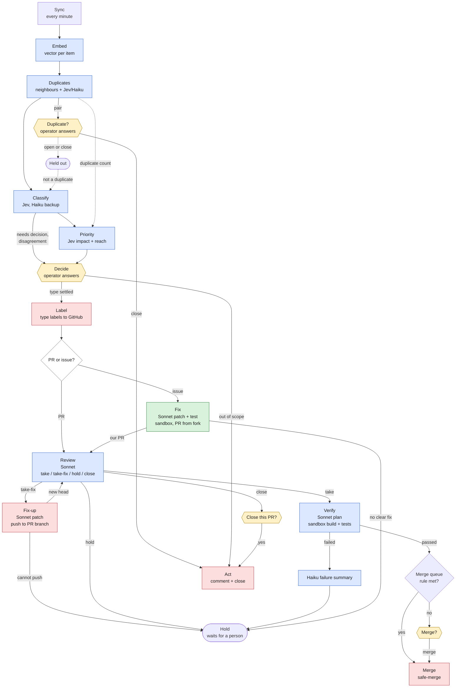

# How the triage pipeline works

The pipeline sorts the craft apps' open issues and PRs (about 21,000), reviews and merges the PRs we want, and fixes clear bugs. Models read, sort and review. People answer the decisions that need judgement, on this dashboard.

## The flow

Yellow boxes are decisions a person answers, blue boxes are model calls, green boxes run in the sandbox, red boxes write to GitHub. Every red box needs the operator's approval for that repo (Repos page) and stays within its daily limit.

Sync, Embed, Duplicates, Classify, Priority and Decide cover the whole org. Label, Review, Fix, Fix-up, Verify, Merge and Act go one or a few repos at a time. Priority scores order the candidates of Decide, Review, Verify and Fix-up, highest first.

## Sync

Every issue, PR and comment of the tracked repos is mirrored into the local database every minute (one org-wide search for changes). Later stages read the mirror and never GitHub directly. Automatic; no model.

## Embed

Each item gets a vector from its title and body. A new vector is made only when the text changes. Runs locally on this machine; no model quota and no limit.

## Duplicates

Finds open issues and PRs that describe the same bug or request as another open item, or one closed within the last year, in the same repo.

- **Candidates.** Nearest neighbours by vector (similarity 0.86 or more, at most 3 per item, same kind). A pair an operator already ruled on is not asked again.
- **Check.** Jev answers first (0.9 or more is a duplicate, 0.1 or less is distinct). Haiku settles the rest.
- **Canonical item.** The closed or merged one, else the one with a merged fix, else the one with 5 or more extra comments, else the older one.
- **Decision.** "Close #x as a duplicate of #y?" with Close, Not a duplicate, Keep both. Only an operator's answer counts.
- **Held out.** While the decision is open or answered close, the item is left out of Decide, Review, Verify, Fix-up and Fix. "Not a duplicate" and "Keep both" release it for good.
- **Hand-off.** A close goes to Act. Confirmed duplicates raise the original's priority.

Models: Jev, Haiku. Daily limit 2000 pairs. Writes nothing to GitHub.

## Classify

Every open item gets one type label (bugfix, performance, missing feature, small extra, plugin candidate, infra) and two flags (security, needs decision).

- Jev first. Under 90 % sure, Haiku gives a second opinion.
- A type is settled when Jev is at 90 % or more, or Haiku agrees with Jev. Disagreements go to Decide.
- Started by the operator for a full pass; the pipeline classifies new and changed items on its own. Daily limit 2000.

## Priority

Each open item gets an impact class and a 0 to 100 score.

| Class | Band | Meaning |
|---|---|---|
| critical | 75 to 100 | Crash, data loss, security hole, broken build or install |
| high | 50 to 75 | A core feature is broken, or a regression |
| normal | 25 to 50 | Anything else |
| low | 0 to 25 | Cosmetic, wording, docs, nice-to-have |

- Jev picks the class; under 90 % sure, Haiku decides.
- Reach moves the score inside the band: commenters, comments, linked PRs, confirmed duplicates, the security flag and age. No model.
- Models run again only when the item's text changes; scores are recomputed from the mirror on every pass.
- Items without a score come after all scored ones. Daily limit 3000 items sent to Jev; raise it for the first pass over a new org.

<!-- work-rank section goes here -->

## Decide

Asks the operator for a scope call on open items that either carry the needs-decision flag (settled), or where Jev and Haiku chose different labels among missing feature, small extra and plugin candidate.

- Each decision has a question, up to four options, a recommendation, up to five facts and a 2 to 4 sentence Sonnet summary.
- An item with an open or answered scope decision is not asked again. Anyone signed in can comment and pick; only the operator's answer counts.

| Answer | Effect |
|---|---|
| `take` | In scope. PRs go to Review |
| `small-extra` | Keep in core, label "small extra" |
| `plugin` | Not for core. Keep open, label "plugin candidate" |
| `close` | Out of scope. Goes to Act |
| `need-info` | Ask how the reference app behaves, then decide again |

Model: Sonnet (summaries). Daily limit 100.

## Label

Writes each settled type label and flag to GitHub. No model.

- Only settled types are labelled. A label a person set is never changed: items with a different type label are skipped and reported.
- Needs the repo's **label approval**. Without it the stage only plans.
- Writes in batches, at most 60 a minute. A re-run skips items already labelled.

## Review

Code review of open, non-draft PRs whose settled type is bugfix, performance, missing feature, small extra or infra. A PR flagged needs-decision waits for a `take` or `small-extra` answer. A PR already reviewed at its current head is skipped; a push brings it back. Reads GitHub, writes nothing.

- **Model.** Sonnet, no tools, one call per batch of related PRs (at most 15 PRs). PR text and diffs are quoted as untrusted data.
- **Input.** Title, body, size (S up to 50 changed lines, M up to 300, L above), CI and merge state, changed files, and the diff of code files. Tests and lockfiles are listed, not diffed.
- **Too large.** Over 1,500 changed code lines, or no diff from GitHub: held without a model call.

| Verdict | Meaning |
|---|---|
| take | Wanted, correct, nothing to change |
| take-fix | Wanted and nearly right; small mechanical fixes are listed |
| hold | Needs a person: unclear reference behaviour, design or scope choice, overlaps, too large |
| close | Wrong or broken beyond a small fix, not wanted, already done, or superseded |

The weaker of two duplicate PRs is held, never closed, until the better one merges. Daily limit 40 PRs.

Hand-off: take goes to Verify, take-fix to Fix-up, close to a "Close this PR?" decision (answered yes, Act closes it), hold waits for a person.

## Fix

Opens a PR for open bugfix issues in public Rust repos where the fix is clear. Needs the repo's **fix approval**.

- **Candidates.** No pending scope decision (needs-decision issues need a `take`), no open PR that mentions the issue, no earlier attempt, not held as a duplicate. Highest priority first.
- **Triage.** Sonnet decides if the fix is clear. If not, the issue is held with the reason.
- **Patch.** Sonnet writes a diff to the listed files plus one regression test. Our code validates it: only listed files, at most 300 changed lines, no binary, symlink or mode changes.
- **Sandbox.** The patched head must build and pass; the test alone on the base commit must fail. Untrusted code runs only there.
- **Rounds.** A failure gets a Haiku summary and a new round. Three failed rounds end the attempt (held).
- **PR.** Pushed to our fork, opened against the repo with "Fixes #N.", and the issue gets one comment, "A PR for this is in progress". The PR then goes through Review like any other.

Models: Sonnet, Haiku. Daily limit 10 attempts.

## Fix-up

For a take-fix review, Sonnet applies the listed small fixes to the contributor's branch, so the PR need not wait for them.

- **Needs** the repo's **push approval**, a PR that maintainers may modify, and no conflict. Otherwise the PR is held ("cannot push"), with no write.
- **Safety.** The checkout is untrusted: no working tree, hooks or filters run. The diff may touch only the files named in the review, at most 300 lines.
- **Push.** One commit "Apply review fixes", pushed with a lease so a branch that moved is left alone, plus one comment from a fixed template.
- **Hand-off.** The new head is reviewed again. At most 2 tries per PR. Daily limit 20 PRs.

## Verify

Builds and tests `take` PRs in the sandbox. Only Rust repos (a `Cargo.toml` at the root), public PRs whose CI does not fail.

- **Plan.** Sonnet, no tools, picks one kind: `ci-enough` (no task), `tests` (up to 5 crates, optional test filters) or `regression` (bugfixes only: a test that fails on the base commit and passes on the head). Our code validates the plan; anything invalid is an error.
- **Result.** Pass or fail comes from exit codes only, never from a model.
- **Failure.** Haiku writes a summary of at most 60 words from the failing step's log (credentials scrubbed, quoted as untrusted). The PR is held.
- **Errors.** An environment error is retried once per head.
- **Stale.** A verification counts only at the head it was made for; a push or a close cancels its tasks.

Models: Sonnet (plan), Haiku (failure summary). Daily limit 30 PRs.

## Merge queue

The queue lists every PR whose latest review is take or take-fix at its current head ([Merge queue](/queue), read-only), with one state each: ready, waiting-ci, ci-failed, conflict, needs-fix-up, waiting-verify, verify-failed, verify-error, needs-decision, decision-answered-merge, declined, refused, merged.

**Merge without asking** only when all of these hold at the PR's current head:

- review verdict is take (not take-fix)
- size S or M
- type is bugfix or infra (tests, CI, docs, build)
- author is on the whitelist (see Contributors)
- CI is green
- Verify passed, or planned "CI is enough"
- GitHub reports it mergeable

A take PR that fails any of the first four gets a "Merge this PR?" decision (Merge, Hold, Close) once Verify has passed. One decision per head, so a push asks again. An answer of merge still needs green CI, a passed Verify and a mergeable PR, and the head must not have moved.

**Merge step.** Needs the repo's **merge approval**. Per PR it refreshes checks, assigns the PR to the pipeline's account, then runs `safe-merge` (squash, or merge when the commits have more than one author). It never calls `gh pr merge` itself and never passes `--allow-pending`. A refusal is recorded with its reason and the PR stays queued; any other error stops the run. No model. Daily limit 10.

## Act

Makes the GitHub comments and closes that follow an operator's answer. No model. Needs the repo's **comment approval**; daily limit 20 items.

| Trigger | Action |
|---|---|
| Scope decision answered `close` | One comment, then close |
| "Close this PR?" answered `close` | One comment, then close the PR |
| Duplicate decision answered `close` | `Duplicate of #y.`, then close |

- **Close this PR?** The step asks it for each PR whose latest review says close at the current head: options Close, Hold, Keep open. A new head asks again, and an answer given at an old head is skipped.
- **Comment rules.** Comments are fixed templates in code (listed on [Prompts](/prompts)): one or two short factual lines, a fixed first sentence and at most `Reason: <text>`, cut to one line of 200 characters with `@` removed. Nothing a model wrote is posted.
- **Before writing,** the step re-reads the item and skips it, without a comment, when it is already closed or merged, gone, or its head moved. A comment is never posted twice.

## Which model does what

| Model | Used for |
|---|---|
| Jev | First sort of every item (classes, duplicates). Very cheap and fast and reports how sure it is: at 90 % or more it matched maintainers' labels 98 % of the time |
| Haiku | Second opinion where Jev is unsure; batch priority and duplicate checks; failure summaries |
| Sonnet | Decision summaries, review, fix-ups, issue fixes, verify plans |
| Opus | Planning and direction only; not called by the pipeline |

[Prompts](/prompts) shows every prompt exactly as sent. The code can call a model only with a registered prompt. Classifiers and Cost show how often the models agree and what each stage costs.

## Claude accounts and agent runs

An agent run is one model call: one `claude -p` call or one Jev request. Each is recorded when it starts and ends (prompt id and version, model, account, item refs, tokens, summary). Prompts and raw output are kept 14 days; the rest 90 days. The Agents page lists runs.

Operators enable accounts on the Accounts page and set a label and calls at once (1 to 100, default 2). Logins and config directories never appear in the API, logs or UI.

Before each call, the runner picks an enabled account with a free slot and headroom (5-hour use under 90 %, weekly use under 95 %; a reading older than 30 minutes counts as unknown), preferring the lowest weekly use. When none qualifies, the call waits. Stages that call Claude show as paused, with the reason, while no account has headroom. Jev calls use no account; their parallelism is the `jev_parallel` setting (default 4).

## Build environments and tasks

Untrusted code (a PR's build and tests) never runs where the GitHub token or a Claude login is. It runs as a task on a build environment, a worker an operator registers.

- **Worker.** Holds no GitHub token, no Claude login and no database access. It fetches public source anonymously by commit and pulls tasks by key.
- **Task.** Names the source (repo, head and base commit), what it requires (OS, toolchains, memory), a plan of steps with timeouts and network setting, an optional patch (1 MiB at most, applied before the first step) and an optional warm build cache key.
- **Scheduling.** Workers claim queued tasks that match their capabilities, by priority. A task without a heartbeat for 2 minutes is requeued once, then fails. Cancelling a task stops it at once.
- **Results are data.** Logs and artifacts are size-capped, typed by content (PNG, JSON, JUnit XML, text) and served with `nosniff` and a sandboxing policy. Nothing a worker sends is executed, rendered as HTML or put in a prompt by the coordinator. A later step that lets a model read it frames it as untrusted.
- **Access.** Worker calls arrive on their own listener, authenticated by key (stored hashed, shown once), with body caps and rate limits. Only operators register environments, rotate keys or cancel tasks, and each is audited. Tasks of repos a viewer cannot see are hidden from that viewer.
- Tasks, logs and artifacts are deleted 30 days after the task ends.

## What needs a person

- **Scope calls**: is this in scope, closer to the reference app, a plug-in rather than core?
- **Reference behaviour** that public sources don't settle.
- **Merges outside the rule** (see Merge queue). Contributors shows who is on the whitelist and why.
- **Closing a PR** the review says to close.

Everything else waits for a decision on this dashboard.

## Trust boundary

- Untrusted code never runs where GitHub or Claude credentials are (see Build environments).
- Only the operator's answers are acted on. The pipeline reads the chosen option, never free text.
- Comments and picks by other people are shown here but never reach a model's prompt.
- All GitHub text is untrusted data: models judge it and never follow instructions in it.
- Every GitHub write (labels, comments, closes, pushes, fix PRs, merges) needs the operator's approval for that repo, given on the Repos page; the CLI reads approvals and cannot set them. Approvals are audited.
- Only operators can turn the pipeline on or off, change limits, manage accounts or cancel jobs. A maintainer or viewer account, even a compromised one, cannot trigger a merge, close, post, label, push or any step.

## Architecture

Three processes share one database. None needs a terminal or Claude session kept open.

| Process | What it does |
|---|---|
| Sync | Copies changes from GitHub into the mirror, every minute |
| Dashboard | Shows everything to people on the access list; records answers, opinions, the pipeline switch and limits. Never runs a step or calls a model |
| Runner | Runs the pipeline steps as jobs, each in its own process, and records progress, logs, results and token use |

Each step has a fixed list of settings (a choice, a tracked repo, a bounded number or a run id). Nothing typed on the dashboard can reach a prompt or a shell. Steps in the same concurrency group run one at a time.

### On and Off

The pipeline starts **Off**. An operator switches it on the Pipeline page or with `craft-auto pipeline on|off`; the switch records who and when. Off cancels waiting automatic jobs and queues no new ones; running jobs finish.

While On, the runner looks for work after each sync, at least every 15 minutes, and when a job ends. It queues a job for each stage that has work, no job queued or running, and limit left. Per-repo stages (Label, Review, Merge, Act, Fix-up, Fix) queue only for repos with the matching approval. A stage whose last three automatic jobs failed, or ended with no items although there was work, waits an hour; one whose last job handled nothing waits 15 minutes. The full classification pass is never started automatically.

### Daily limits

Limits count items handled per stage per day (from 00:00 UTC), including by failed or stopped jobs. Operators change them on the Pipeline page or with `craft-auto pipeline limit`. Empty means no limit; 0 pauses the stage. The page shows why a stage cannot start.

| Stage | Limit | Stage | Limit |
|---|---|---|---|
| Classify | 2000 | Verify | 30 |
| Priority | 3000 | Merge | 10 |
| Duplicates | 2000 | Act | 20 |
| Decide | 100 | Fix-up | 20 |
| Review | 40 | Fix | 10 |

Embed, checks and Label have no limit.

| Who | On the Pipeline page |
|---|---|
| Anyone signed in | Sees the switch, limits and use today, every stage and job with its log, result and cost, and recent syncs |
| Operator | Also turns the pipeline on and off, changes limits and cancels jobs; all audited |

Logs hold no secrets; anything that looks like a token is hidden.

## Commands

Dry run is the default for every writing command; `--apply` writes (and still refuses unapproved repos).

| Command | Stage |
|---|---|
| `craft-auto sync`, `embed`, `dupes`, `classify`, `prioritize` | Sync to Priority |
| `craft-auto decide [--repo R]` | Decide |
| `craft-auto labels ensure\|plan\|apply --repo R` | Label |
| `craft-auto checks --repo R`, `review --repo R` | Review |
| `craft-auto fixissue --repo R`, `fixissue-collect` | Fix |
| `craft-auto fixup --repo R` | Fix-up |
| `craft-auto verify --repo R`, `verify-collect` | Verify |
| `craft-auto queue`, `merge --repo R` | Merge queue |
| `craft-auto act --repo R` | Act |
| `craft-auto pipeline on\|off\|limit`, `accounts list\|set\|jev` | Switch, limits, accounts |
